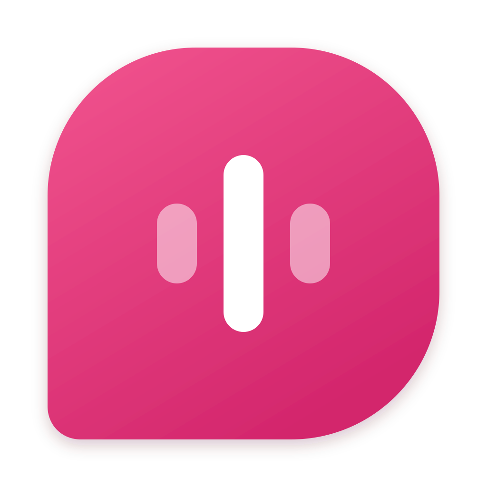
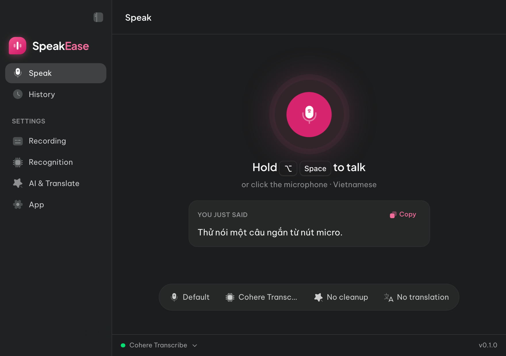
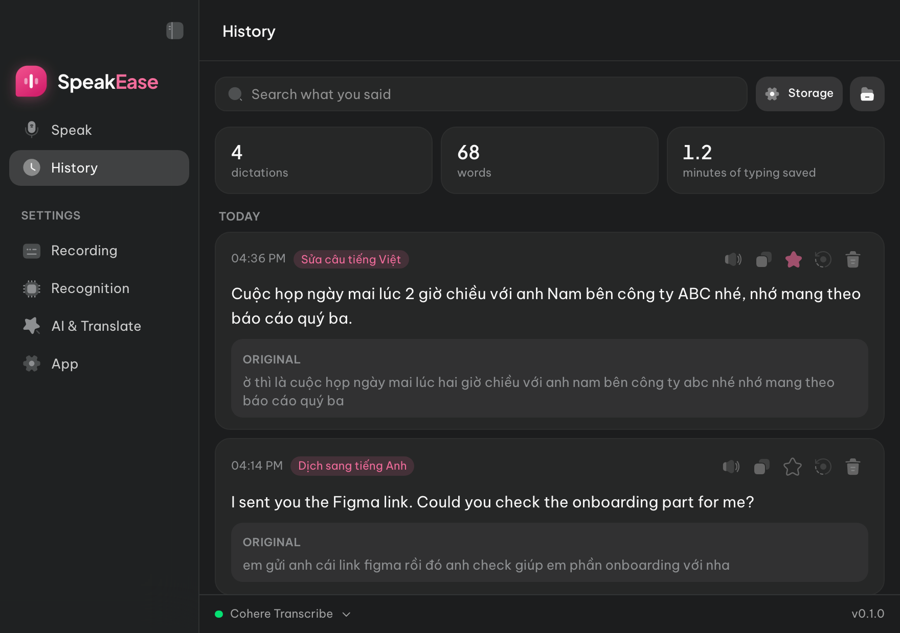
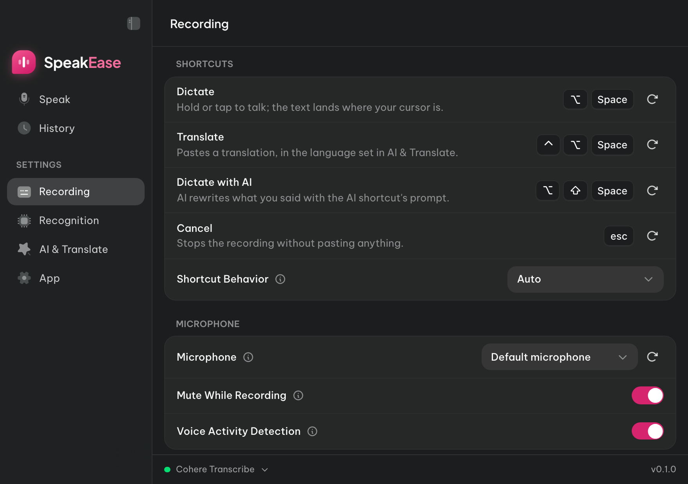
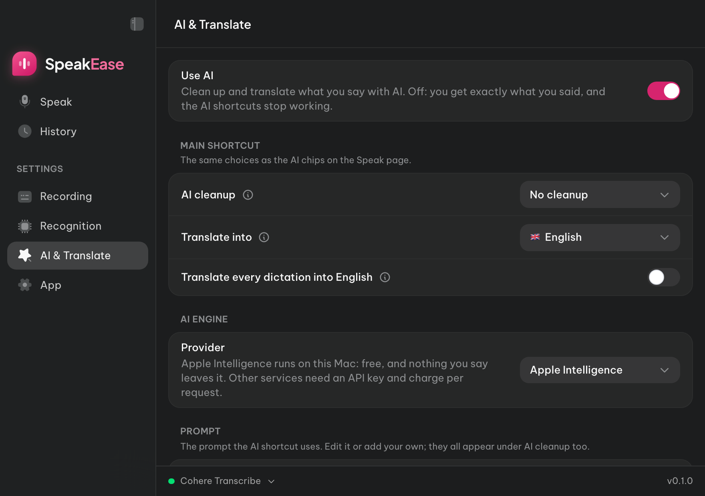

<p align="center"></p>

# SpeakEase

**Free and source-available — for noncommercial use** ([PolyForm Noncommercial 1.0.0](LICENSE); the Handy code it is built on stays MIT, see [NOTICE.md](NOTICE.md)).

A dictation app for macOS, **made for Vietnamese first**. Hold a key, speak, let go, and the text is pasted where your cursor is, in any app. Speech is recognised **on your Mac** and goes nowhere. AI cleanup and translation run on **Apple Intelligence, on your Mac**, or with your own API key if you choose one.

> **Tài liệu tiếng Việt:** [README.md](README.md)

<p align="center">
  
  
</p>
<p align="center">
  
  
</p>
<p align="center"><sub>Taken from the interface preview, with example data.</sub></p>

## What it does

- **Dictate anywhere.** Hold <kbd>⌥ Space</kbd> (or click the microphone on the Speak page), speak, let go: the text lands in the app you are using.
- **On-device recognition.** Pick and download a model inside the app; it works offline after that.
- **AI cleanup.** Punctuation, capitalised names, numbers written as digits, filler words gone. Ships with *Vietnamese cleanup* and *Write as an email* prompts; add your own.
- **Translate as you speak.** Speak Vietnamese, paste English (or one of 11 other languages): for every dictation, or only with the translate shortcut.
- **Custom words.** Teach it names, brands and terms so it spells them right.
- **History.** Search what you said, play it back, copy, re-transcribe, and see how many minutes of typing you saved. All of it stays on your Mac.
- **Quick changes from the menu bar.** Listening language, model, AI cleanup and translation, without opening the window.
- **Vietnamese and English interface**, following your Mac's language.

### Default shortcuts

| Keys | What it does |
| --- | --- |
| <kbd>⌥ Space</kbd> | Dictate: hold or tap to talk; the text lands where your cursor is |
| <kbd>⌃ ⌥ Space</kbd> | Translate: pastes a translation, in the language set in *AI & Translate* (English by default) |
| <kbd>⌥ ⇧ Space</kbd> | Dictate with AI: AI rewrites what you said with the AI shortcut's prompt |
| <kbd>Esc</kbd> | Cancel the recording |

Change them in **Settings › Recording**.

### Which model hears Vietnamese best?

Measured on 60 read sentences (12.9 minutes) of Google FLEURS Vietnamese, with the app's own engine. Word error rate, lower is better:

| Model | WER |
| --- | --- |
| Cohere Transcribe | **6.3 %** |
| Qwen3-ASR 1.7B | 6.8 % |
| Fun-ASR MLT Nano | 7.4 % |
| Moonshine Base (vi) | 7.8 % ¹ |
| Whisper Large v3 Turbo | 8.2 % |
| Qwen3-ASR 0.6B | 8.5 % |
| Nemotron 3.5 Streaming 0.6B | 11.7 % |

<sub>¹ Moonshine could not transcribe the two clips longer than ~25 seconds, so its rate covers 58 sentences.</sub>

## Install

Ready-made builds will be posted on the [Releases page](https://github.com/wblekhoa/speakease/releases). Until then, build it from source:

1. Install the Xcode Command Line Tools (`xcode-select --install`), [Rust](https://rustup.rs/) and [Bun](https://bun.sh/).
2. Run:

   ```bash
   git clone https://github.com/wblekhoa/speakease.git
   cd speakease
   bun install
   bun run tauri build --bundles app --config '{"bundle":{"macOS":{"signingIdentity":"-"}}}'
   ```

3. Drag `src-tauri/target/release/bundle/macos/SpeakEase.app` into **Applications**.

The command signs the app ad hoc, since you do not have the author's certificate. On first launch macOS asks for **Microphone** (to listen) and **Accessibility** (to paste into other apps). Development setup: [BUILD.md](BUILD.md).

### Requirements

| | |
| --- | --- |
| Mac | Apple Silicon (M1 or later) |
| macOS | Tested on macOS 27. On-device AI cleanup needs Apple Intelligence (macOS 26 or later, on a supported Mac); without it, use your own API key or switch AI off |
| Disk | The app, plus the model you choose (Cohere Transcribe is about 1.6 GB) |
| Network | Only to download models, and for an online AI service you choose |

## Privacy

- Audio and the recognised text **never leave your Mac**. History and recordings live in `~/Library/Application Support/com.wblekhoa.speakease/`.
- AI cleanup runs on Apple Intelligence **on your Mac** by default. Only if you add an API key for a service (OpenAI, Anthropic, OpenRouter…) is **text** (never audio) sent straight to that service.
- No account, no ads, no usage tracking, no silent updates.

Details: [PRIVACY.md](PRIVACY.md).

## Bugs and contributions

Found a bug? Open [an issue](https://github.com/wblekhoa/speakease/issues/new/choose). Security problems go privately, as [SECURITY.md](SECURITY.md) describes. How to contribute: [CONTRIBUTING.md](CONTRIBUTING.md).

## Licence and thanks

SpeakEase is built on [Handy](https://github.com/cjpais/Handy) by CJ Pais, an excellent open-source transcription app. Handy's code keeps its MIT licence ([LICENSE-MIT-HANDY](LICENSE-MIT-HANDY)); what SpeakEase adds is under PolyForm Noncommercial 1.0.0 ([LICENSE](LICENSE)). Where one ends and the other begins: [NOTICE.md](NOTICE.md).

Speech models come from their publishers under their own licences, and are only downloaded when you choose them.
