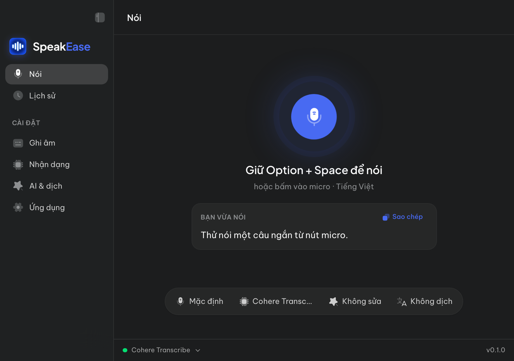
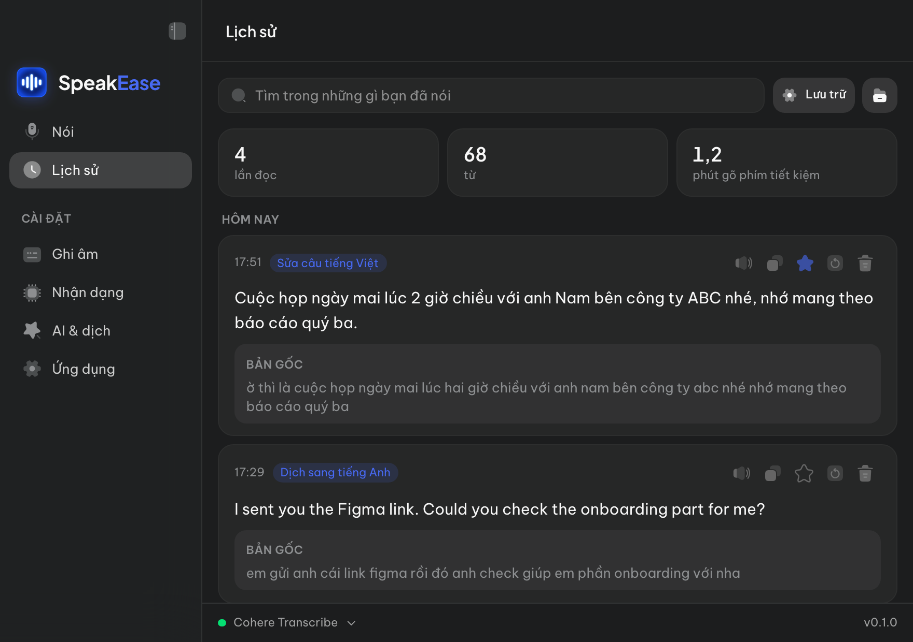
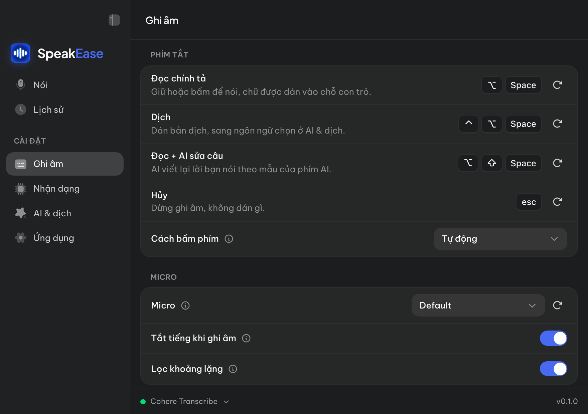
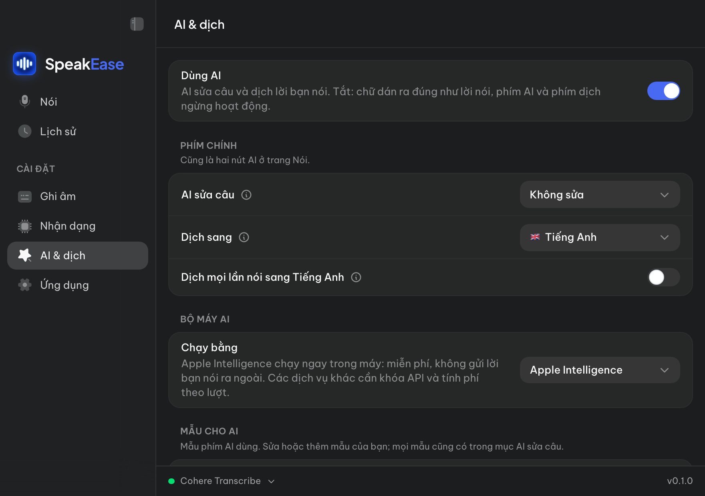

# SpeakEase

**Miễn phí, mã nguồn công khai — dùng phi thương mại** ([PolyForm Noncommercial 1.0.0](LICENSE); phần gốc Handy vẫn là MIT, xem [NOTICE.md](NOTICE.md)).

Ứng dụng đọc chính tả cho macOS, **làm cho tiếng Việt trước tiên**. Giữ một phím, nói, thả ra là chữ được dán vào đúng chỗ con trỏ, trong bất kỳ app nào. Giọng nói được nhận dạng **ngay trên máy bạn**, không gửi đi đâu. AI sửa câu và dịch chạy bằng **Apple Intelligence trên máy**, hoặc bằng khoá API của chính bạn nếu bạn tự chọn.

> **English documentation:** [README.en.md](README.en.md)

<p align="center">
  
  
</p>
<p align="center">
  
  
</p>
<p align="center"><sub>Ảnh chụp từ bản xem trước giao diện, dữ liệu là ví dụ.</sub></p>

## Làm được gì

- **Đọc chính tả ở mọi nơi.** Giữ <kbd>⌥ Space</kbd> (hoặc bấm nút micro trên trang Nói), nói, thả ra: chữ được dán vào app đang mở.
- **Nhận dạng trên máy.** Chọn và tải mô hình ngay trong app; sau đó chạy offline.
- **AI sửa câu.** Thêm dấu câu, viết hoa tên riêng, đổi số đọc bằng chữ thành chữ số, bỏ từ đệm (ờ, ừm, à…). Có sẵn mẫu *Sửa câu tiếng Việt* và *Viết thành email*; bạn tự thêm được mẫu của mình.
- **Dịch khi nói.** Nói tiếng Việt, dán ra tiếng Anh (hoặc 11 ngôn ngữ khác). Bật cho mọi lần nói, hoặc chỉ khi bấm phím dịch riêng.
- **Từ riêng.** Dạy app tên người, tên công ty, thuật ngữ để nó viết đúng.
- **Lịch sử.** Tìm theo nội dung, nghe lại, sao chép, nhận dạng lại, xem đã tiết kiệm bao nhiêu phút gõ phím. Mọi thứ nằm trên máy bạn.
- **Đổi nhanh từ thanh menu.** Ngôn ngữ nghe, mô hình, AI sửa câu, dịch sang — không cần mở cửa sổ.
- **Giao diện tiếng Việt và tiếng Anh**, tự theo ngôn ngữ của máy.

### Phím tắt mặc định

| Phím | Làm gì |
| --- | --- |
| <kbd>⌥ Space</kbd> | Đọc chính tả: giữ hoặc bấm để nói, chữ được dán vào chỗ con trỏ |
| <kbd>⌃ ⌥ Space</kbd> | Dịch: dán bản dịch, sang ngôn ngữ chọn ở *AI & dịch* (mặc định tiếng Anh) |
| <kbd>⌥ ⇧ Space</kbd> | Đọc + AI sửa câu: AI viết lại theo mẫu của phím AI |
| <kbd>Esc</kbd> | Huỷ lần ghi âm đang chạy |

Đổi phím ở **Cài đặt › Ghi âm**.

### Mô hình nào nghe tiếng Việt tốt nhất?

Đo trên 60 câu đọc (12,9 phút) của bộ Google FLEURS tiếng Việt, bằng chính bộ máy của app. Tỉ lệ lỗi từ (WER), càng thấp càng tốt:

| Mô hình | WER |
| --- | --- |
| Cohere Transcribe | **6,3 %** |
| Qwen3-ASR 1.7B | 6,8 % |
| Fun-ASR MLT Nano | 7,4 % |
| Moonshine Base (vi) | 7,8 % ¹ |
| Whisper Large v3 Turbo | 8,2 % |
| Qwen3-ASR 0.6B | 8,5 % |
| Nemotron 3.5 Streaming 0.6B | 11,7 % |

<sub>¹ Moonshine không chép được hai đoạn dài hơn ~25 giây, nên tính trên 58 câu.</sub>

## Cài đặt

Bản cài sẵn sẽ được đăng ở [trang Releases](https://github.com/wblekhoa/speakease/releases). Trong lúc chờ, bạn build từ mã nguồn:

1. Cài Xcode Command Line Tools (`xcode-select --install`), [Rust](https://rustup.rs/) và [Bun](https://bun.sh/).
2. Chạy:

   ```bash
   git clone https://github.com/wblekhoa/speakease.git
   cd speakease
   bun install
   bun run tauri build --bundles app --config '{"bundle":{"macOS":{"signingIdentity":"-"}}}'
   ```

3. Kéo `src-tauri/target/release/bundle/macos/SpeakEase.app` vào thư mục **Applications**.

Lệnh trên ký app theo kiểu ad-hoc vì bạn không có chứng chỉ của tác giả. Khi mở lần đầu, macOS sẽ hỏi quyền **Micro** (để nghe) và **Trợ năng** (để dán chữ vào app khác). Dựng môi trường phát triển: [BUILD.md](BUILD.md).

### Máy cần gì

| Yêu cầu | Chi tiết |
| --- | --- |
| Máy Mac | Apple Silicon (M1 trở lên) |
| macOS | Đã thử trên macOS 27. AI sửa câu ngay trên máy cần Apple Intelligence (macOS 26 trở lên, trên máy hỗ trợ); không có thì dùng khoá API của bạn hoặc tắt AI |
| Dung lượng | App, cộng mô hình bạn chọn tải (ví dụ Cohere Transcribe ~1,6 GB) |
| Mạng | Chỉ cần khi tải mô hình, và khi bạn tự chọn một dịch vụ AI trên mạng |

## Quyền riêng tư

- Âm thanh và chữ nhận dạng **không rời khỏi máy**. Lịch sử và bản ghi âm nằm ở `~/Library/Application Support/com.wblekhoa.speakease/`.
- AI sửa câu mặc định chạy bằng Apple Intelligence **trên máy**. Chỉ khi bạn tự thêm khoá API của một dịch vụ (OpenAI, Anthropic, OpenRouter…) thì **chữ** (không phải âm thanh) mới được gửi thẳng tới dịch vụ đó.
- Không tài khoản, không quảng cáo, không đo lường sử dụng, không tự cập nhật ngầm.

Chi tiết: [PRIVACY.md](PRIVACY.md).

## Báo lỗi và đóng góp

Gặp lỗi? Mở [một issue](https://github.com/wblekhoa/speakease/issues/new/choose). Lỗi bảo mật thì báo riêng theo [SECURITY.md](SECURITY.md). Cách đóng góp: [CONTRIBUTING.md](CONTRIBUTING.md).

## Giấy phép và lời cảm ơn

SpeakEase được xây trên [Handy](https://github.com/cjpais/Handy) của CJ Pais — một app chép lời mã nguồn mở rất tốt. Phần của Handy giữ giấy phép MIT ([LICENSE-MIT-HANDY](LICENSE-MIT-HANDY)); phần SpeakEase viết thêm theo PolyForm Noncommercial 1.0.0 ([LICENSE](LICENSE)). Ranh giới giữa hai phần: [NOTICE.md](NOTICE.md).

Mô hình nhận dạng do các nhà phát hành của chúng cung cấp, theo giấy phép riêng, và chỉ được tải khi bạn chọn.
