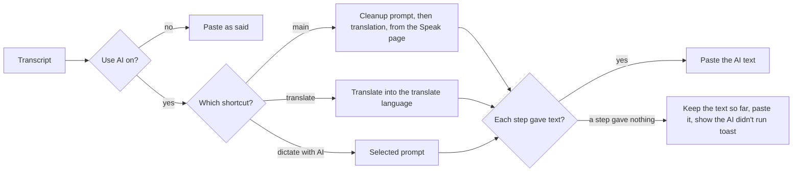

# SpeakEase — AI cleanup and translation (UX)

> Feature master: read this file first to understand what AI does to a dictation before it is pasted. Deeper rules
> live in `logic/ai-cleanup.md`.

## Purpose

- Problem: raw speech recognition lacks punctuation and capitals, writes numbers as words, keeps filler words, and
  stays in the language spoken.
- Audience: users who want finished text, or text in another language, without editing.
- Success signal: the pasted text needs no fixing, and an AI failure never costs the user what they said.

## Scope

- Included: the **Use AI** switch, the AI engine (Apple Intelligence on the Mac, or an online service with the user's
  own key), prompts (_Vietnamese cleanup_, _Write as an email_, the translate prompt, the user's own), the Speak page
  quick choices **AI cleanup** and **Translate to**, the translate and dictate-with-AI shortcuts, the tray menu items,
  the "AI didn't run" notice.
- Excluded: recording and recognition (`ux/dictation.md`).

## Current truth

- **Settings › AI & Translate** holds one **Use AI** switch. Off: no AI step runs anywhere - the Speak page shows
  "AI is switched off, so nothing is cleaned up or translated. You get exactly what you said." with **Turn on AI**,
  and the two AI shortcuts are not registered.
- **Engine**: Apple Intelligence on the Mac by default (needs macOS 26+ on a supported Mac). With an API key for an
  online service (OpenAI, Anthropic, OpenRouter, Groq…), only text is sent there, never audio.
- **Main shortcut (⌥ Space)** follows the Speak page's quick choices: **AI cleanup** (a prompt, or "No cleanup -
  Paste exactly what you said") and **Translate to** (a language, or "No translation - Keep the language you speak").
  Cleanup runs first, then translation.
- **Translate shortcut (⌃ ⌥ Space)** always translates, into the translate language (English until another is
  chosen). Twelve targets: English, Vietnamese, Japanese, Korean, Chinese (Simplified), French, German, Spanish, Thai,
  Indonesian, Russian, Portuguese. Anything other than English goes through English first.
- **Dictate with AI (⌥ ⇧ Space)** rewrites with the prompt selected in AI & Translate.
- **Tray menu**: AI cleanup and translation can be changed without opening the window.
- **When AI gives nothing back** (Apple Intelligence unavailable, a refusal, a provider or key error), what was said
  is pasted as is, and a toast says "AI didn't run, so what you said was pasted as is" with **Check AI**.
- A user upgrading from a Handy settings store gets the SpeakEase prompts once, with AI switched on; prompts they
  later delete stay deleted, except the translate prompt, which the translate shortcut needs.

## Screens and states

| Screen                    | States                                                                                          | Entry                                  | Exit / next                   |
| ------------------------- | ----------------------------------------------------------------------------------------------- | -------------------------------------- | ----------------------------- |
| Speak page › AI cleanup   | a prompt · No cleanup · AI off (Turn on AI)                                                     | Speak page                             | choice saved at once          |
| Speak page › Translate to | a language (searchable) · No translation · AI off                                               | Speak page                             | choice saved at once          |
| AI & Translate            | Use AI on/off · engine (Apple Intelligence / service + key) · prompts list · translate language | sidebar › AI & Translate               | another section               |
| Tray menu                 | AI cleanup submenu · translation submenu · listening language · model                           | menu bar icon                          | choice applied                |
| "AI didn't run" toast     | shown after a skipped step                                                                      | a dictation whose AI step gave nothing | Check AI opens AI & Translate |

## Flow

## Reading order

| File                  | Role                                                 |
| --------------------- | ---------------------------------------------------- |
| this file             | current truth                                        |
| `logic/ai-cleanup.md` | rules + REQ-IDs                                      |
| `ux/dictation.md`     | the shortcuts and the Speak page this feature shares |

## Change log

- 2026-10-11: created (doc-engine rollout).
