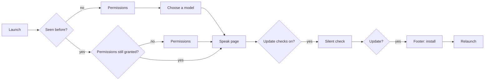

# SpeakEase — App shell (UX)

> Feature master: read this file first to understand the window around the features - the side column, the App
> page, the tray and app menus, first launch and updates. Deeper rules live in `logic/app-shell.md`.

## Purpose

- Problem: dictation happens in other apps; the SpeakEase window should be quick to reach, quick to set up, and stay
  out of the way the rest of the time.
- Audience: every user - on first launch, when changing how the app starts or pastes, and when an update arrives.
- Success signal: a new user dictates after granting two permissions and picking one model; the side column is at the
  width the user left it.

## Scope

- Included: the window's side column (sections, fold, resize), the **App** settings page, the tray menu items that
  open the window or check for updates, the app menu's **Check for Updates…**, first launch, and update installs.
- Excluded: what each section contains - Speak, Recording and Recognition (`ux/dictation.md`), AI & Translate
  (`ux/ai-cleanup.md`), History (`ux/history.md`); the tray's AI, language and model submenus (`ux/ai-cleanup.md`).

## Current truth

- **Side column**, flush with the window's left edge with the Mac's window buttons in its top corner. **Speak**,
  **Files & links** and **History** come first; under a **Settings** caption follow **Recording**, **Recognition**, **AI & Translate** and
  **App** - the order a dictation goes through. **Debug** appears only in debug mode (⌘⇧D).
- **Interface language** sits at the foot of the column: a globe with the current language (Tiếng Việt / English);
  click it for a menu with each language in its own name, the current one ticked. Folded, it is a square key with a
  tooltip and the menu opens beside it. App › Appearance keeps the same choice.
- **Folding**: the switch at the top folds the column to a rail of square icon keys, each naming its section in a
  tooltip; the same switch opens it.
- **Resizing by hand**: the column's right edge darkens under the pointer. Dragging it resizes the column; dragging
  it well in folds it, and dragging a folded rail's edge out opens it - in the same drag, so the user can change their
  mind before letting go. Past the narrowest or widest width the edge resists like a rubber band and springs back on
  release. Double-click the edge for the default width (or to open a folded column). The tooltip on the edge says so.
- The fold and the width are kept on this Mac across relaunches.
- **App page** groups: **Appearance** (interface language, theme), **Startup** (launch at login, start hidden, show
  the tray icon), **Output** (how text is pasted, typing tool, clipboard, press Enter after, trailing space),
  **Experimental** (extra switches appear when it is on), and **About** (version, automatic update checks, app data
  and log folders, and a **Built on Handy** credit linking to its source). Descriptions sit behind an info icon.
- **Tray menu**: **Open SpeakEase** (window on Speak), **History** (window on History) and **Check for Updates…**
  (it works whether or not automatic checks are on), besides the dictation and AI items. With Experimental on, a
  **Live subtitles** item turns subtitles on or off (`ux/live-subtitles.md`).
- **App menu**: **SpeakEase › Check for Updates…** under About.
- **Updates**: checked once at launch when the **Check for Updates** switch in App is on; a check by hand (footer,
  menu or tray) works either way; an available update shows in the window's footer, downloads with a
  progress figure and relaunches the app. A check the user asked for that fails shows "Couldn't check for updates. Check your connection and try again.";
  the launch check never interrupts.
- **First launch**: a permissions step (Accessibility to paste, Microphone to listen), then a model to download; the
  app then opens on Speak. A returning user who lost a permission sees only the permissions step.

## Screens and states

| Screen                | States                                                                 | Entry                           | Exit / next                        |
| --------------------- | ---------------------------------------------------------------------- | ------------------------------- | ---------------------------------- |
| Side column           | open (180-320 px) · folded rail · dragging · rubber band               | always shown with the window    | a section                          |
| App page              | experimental off · experimental on (extra rows)                        | sidebar › App                   | another section                    |
| Footer update control | idle · checking · up to date · update available · downloading · failed | launch check, menu, tray        | relaunch into the new version      |
| Permissions step      | waiting · Accessibility granted · Microphone granted · both granted    | first launch; a permission lost | model step (new) / app (returning) |
| Model step            | choosing · download started                                            | first launch after permissions  | Speak page                         |

## Flow

## Reading order

| File                 | Role                               |
| -------------------- | ---------------------------------- |
| this file            | current truth                      |
| `logic/app-shell.md` | rules + REQ-IDs (SE-APP-…)         |
| `ux/dictation.md`    | Speak, Recording, Recognition      |
| `decisions.md`       | why the updater is SpeakEase's own |

## Change log

- 2026-10-20: the tray gains a Live subtitles item while Experimental is on.
- 2026-10-14: interface language menu at the foot of the side column.
- 2026-10-14: Files joins Speak and History at the top of the side column.
- 2026-10-13: Check for Updates… by hand now works with automatic checks off.
- 2026-10-13: created, covering the side column (fold and resize by drag, 10/10), the App page, tray and app menu
  entries, updates and first launch.
