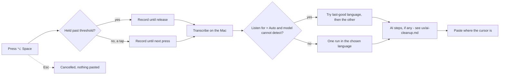

# SpeakEase — Dictation (UX)

> Feature master: read this file first to understand how a user speaks and gets text. Deeper rules live in
> `logic/dictation.md`. AI cleanup and translation of the result are in `ux/ai-cleanup.md`.

## Purpose

- Problem: typing Vietnamese is slow; the user wants to say it and have it typed where the cursor is.
- Audience: every user, many times a day, from any app.
- Success signal: speech in, text pasted in the frontmost app, without opening the SpeakEase window.

## Scope

- Included: the shortcuts (dictate, translate, dictate with AI, cancel), hold versus tap, the recording overlay, the
  Speak page (microphone button, "You just said", quick choices), the "Listen for" language, model suggestions in
  Recognition, permissions on first launch.
- Excluded: what AI does to the text (`ux/ai-cleanup.md`); the record of past dictations (`ux/history.md`).

## Current truth

- **Shortcuts** (defaults, changeable in Settings › Recording): <kbd>⌥ Space</kbd> dictate · <kbd>⌃ ⌥ Space</kbd>
  translate · <kbd>⌥ ⇧ Space</kbd> dictate with AI · <kbd>Esc</kbd> cancel the recording.
- **Hold or tap**: holding the key longer than the hold threshold (300 ms by default) records until it is released;
  a short tap keeps recording until the next press. This "hold or toggle" behaviour is the default activation.
- **Speak page** (first item in the sidebar): a large microphone button that dictates without the shortcut ("Click to
  start talking" → "Listening… click to stop" → "Transcribing…"), the hint "Hold ⌥ Space to talk", a **You just
  said** card with Copy, and quick choices for microphone, model, **Listen for**, AI cleanup and Translate to.
- **Listen for**: Vietnamese, English, another language, or **Auto** ("Detect the language"). With Auto and a model
  that cannot detect the language, the hint reads "Tries Vietnamese and English, remembers what you speak".
- **Model suggestions** (Recognition and the Speak page): for Vietnamese, only models measured on Vietnamese are
  suggested, labelled best / balanced / live / light, with their word error rate; Cohere Transcribe (6.3 %) is best.
  For other languages, suggestions come from the catalog's accuracy and speed scores.
- **Output**: the text is pasted where the cursor is, in the frontmost app. If transcription gives nothing usable the
  user sees a toast naming why (no model ready, could not make out the speech) with a way forward.
- First launch asks for **Microphone** (to listen) and **Accessibility** (to paste into other apps).

## Screens and states

| Screen                          | States                                                                                         | Entry                                  | Exit / next                       |
| ------------------------------- | ---------------------------------------------------------------------------------------------- | -------------------------------------- | --------------------------------- |
| Overlay (while recording)       | recording · transcribing · cancelled                                                           | a dictation shortcut                   | text pasted, or nothing on cancel |
| Speak page                      | idle · listening · transcribing · result ("You just said") · no model                          | sidebar › Speak; tray › Open SpeakEase | another section                   |
| Quick choices (Speak page)      | microphone · model · Listen for (Auto shows the "tries both" hint) · AI cleanup · Translate to | Speak page                             | choice saved at once              |
| Recognition › model suggestions | language chosen (best / balanced / live / light) · "all" (no suggestions)                      | sidebar › Recognition                  | download or select a model        |
| Error toast                     | no model ready · could not make out speech · paste failed · microphone denied                  | a failed dictation                     | action opens the relevant section |

## Flow

## Reading order

| File                 | Role                                         |
| -------------------- | -------------------------------------------- |
| this file            | current truth                                |
| `logic/dictation.md` | rules + REQ-IDs                              |
| `ux/ai-cleanup.md`   | what happens to the text before it is pasted |

## Change log

- 2026-10-11: created (doc-engine rollout).
