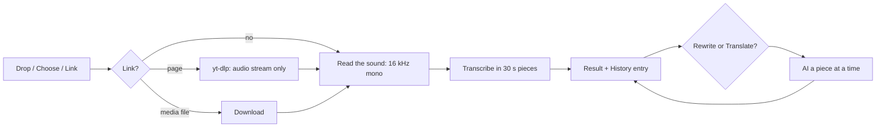

# SpeakEase — Files (UX)

> Feature master: read this file first to understand how a user turns a recording, a video or a link into text and
> then rewrites or translates it. Deeper rules live in `logic/files.md`.

## Purpose

- Problem: the words someone needs are often already recorded - a meeting, an interview, a YouTube video - and
  typing them out takes as long as the recording.
- Audience: anyone with Vietnamese (or other) speech in a file: creators writing scripts and descriptions, people
  taking notes from meetings or lectures.
- Success signal: drop a file, get the text in seconds, rewrite or translate it with one more choice.

## Scope

- Included: the **Files & links** section ("Tệp/liên kết", between Speak and History): drop area, Choose a file, paste a link, progress and
  Cancel, the result with Copy / Save .txt / Rewrite / Translate, recent files; file entries in History.
- Excluded: subtitles with timestamps (.srt), speaker names, MKV/WebM, bundled YouTube downloading - see
  `logic/files.md` Open questions.

## Current truth

- **Bring a file in** three ways: drop it on the window from any page (it opens Files & links), **Choose a file**, or paste a
  link and press **Get the words**. Formats: MP3, M4A, MP4, MOV, WAV, FLAC, OGG. Only the sound is used; a video's
  picture is never processed, so a large video is as quick as its sound.
- **Several files** - dropped together or chosen together - wait in a line and run one after another; the progress
  card says how many wait, and Cancel stops the line.
- **Progress** names the step and the part being worked on - downloading the sound, reading the sound,
  transcribing "part 4 of 21" - with a bar that keeps creeping between parts and a moving sheen, so a slow AI part
  never looks frozen; the elapsed time and the time left sit beside it, with **Cancel**.
- **The result** shows the file's name, a word count and the text, with **Copy** and **Save .txt**. **Rewrite…**
  offers the prompts from AI & Translate; **Translate to…** the same languages as the Speak page. The AI version
  shows on top with the **Original** under it. With AI off, both menus are greyed out and a link turns AI on.
- **Recent files** lists the last six files; choosing one shows its text again.
- **In History** a file shows its name beside the time, and its text is folded to six lines with **Show all**.
  Play back and Re-transcribe work as for dictations. Every card, dictation or file, has a **Rewrite or translate**
  button that opens the same prompts and languages in the card.
- **Links**: a link to an audio or video file works as it is. YouTube and other video pages need yt-dlp installed
  (`brew install yt-dlp`); the message says so.
- **Errors** say what went wrong and what to do: unsupported format, no sound, no speech, bad link, download failed,
  needs yt-dlp, no model, another file in progress.

## Screens and states

| Screen        | States                                                                       | Entry                      | Exit / next                            |
| ------------- | ---------------------------------------------------------------------------- | -------------------------- | -------------------------------------- |
| Drop area     | empty (large) · with a result (short band) · file dragged over (highlighted) | sidebar › Files            | a file or link starts a job            |
| Progress card | downloading · reading · transcribing (parts) · AI (parts)                    | a job starts               | result · error toast · Cancel          |
| Result card   | original only · AI version + original · AI off (menus greyed)                | job done, or a recent file | Copy · Save .txt · Rewrite · Translate |
| History card  | folded (6 lines) · expanded                                                  | sidebar › History          | Show all / Show less                   |

## Flow

## Reading order

| File                 | Role                                  |
| -------------------- | ------------------------------------- |
| this file            | current truth                         |
| `logic/files.md`     | rules + REQ-IDs (SE-FILE-…)           |
| `logic/dictation.md` | SE-REC-008, the 30 s pieces           |
| `ux/ai-cleanup.md`   | the prompts and languages reused here |

## Change log

- 2026-10-15: drop on any page, a line of files, refused AI pieces kept with a notice.
- 2026-10-14: progress keeps moving and shows elapsed time and time left.
- 2026-10-14: created with the first version of Files.
