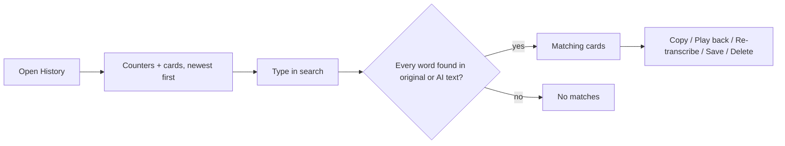

# SpeakEase — History (UX)

> Feature master: read this file first to understand how a user finds, reuses and checks past dictations. Deeper
> rules live in `logic/history.md`.

## Purpose

- Problem: a dictation pasted into the wrong window, or cleaned up wrongly by AI, is lost unless the app keeps it.
- Audience: every user, after a dictation went somewhere unexpected or needs reusing.
- Success signal: the user finds a past dictation by a word they remember, and can see what they actually said
  under the AI version.

## Scope

- Included: the History section - search, counters, cards per dictation (AI version, original, badges), playback,
  copy, save, delete, re-transcribe, Storage settings.
- Excluded: making a dictation (`ux/dictation.md`), the AI steps themselves (`ux/ai-cleanup.md`).

## Current truth

- **Search** ("Search what you said") matches every word typed, in any case - "đà NẴNG" finds "Đà Nẵng" - in both
  the original and the AI version. No match shows "No matches".
- **Counters** at the top: dictations, words, and about how many minutes of typing were saved.
- **One card per dictation**, grouped by Today / Yesterday / date. A card with an AI version shows it first, with an
  **AI** or **Translated** badge, and the **Original** in an inset box under it.
- Per card: **Play back** the recording, **Copy**, **Save** (kept beyond the limit), **Delete**, **Re-transcribe**
  (useful after switching model or language).
- **Storage** sets how many dictations are kept and when recordings are deleted. Everything stays on the Mac.

## Screens and states

| Screen  | States                                                                                      | Entry             | Exit / next         |
| ------- | ------------------------------------------------------------------------------------------- | ----------------- | ------------------- |
| History | loading · empty ("No transcriptions yet…") · list · search with results · no matches        | sidebar › History | another section     |
| Card    | plain · with AI version + Original · re-transcribing · transcription failed (retry) · saved | History list      | actions on the card |
| Storage | history limit · recording retention period                                                  | History › Storage | back to the list    |

## Flow

## Reading order

| File               | Role            |
| ------------------ | --------------- |
| this file          | current truth   |
| `logic/history.md` | rules + REQ-IDs |

## Change log

- 2026-10-11: created (doc-engine rollout).
