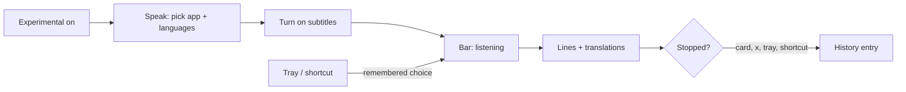

# SpeakEase — Live subtitles (UX)

> Feature master: read this file first to understand how a user subtitles another app's speech in their own language.
> Deeper rules live in `logic/live-subtitles.md`; the beta plan and its measurements in
> `ai-memory/plans/live-subtitles-beta.md`.

## Purpose

- Problem: a video, call or podcast in a language the user follows slowly; YouTube's own captions cover only YouTube
  and translate line by line without the topic.
- Audience: the owner first, then anyone who turns on App › Experimental (beta).
- Success signal: the translation of a line is on screen within 3 s of the speaker finishing it, reads naturally, and
  works for YouTube in a browser, Zoom and a podcast app.

## Scope

- Included: the Live subtitles card on Speak, the floating bar, the tray item, the shortcut on Recording, the History
  entry a session leaves.
- Excluded: dictation (`ux/dictation.md`); the History page itself (`ux/history.md`); cloud translation (owner,
  20/10: on-device only).

## Current truth

- **Where it lives**: with App › Experimental on and macOS 14.2 or later, Speak shows a **Live subtitles · Beta** card
  above the quick-settings bar; Recording lists a **Live subtitles** shortcut (⌃⌥⌘S by default); the tray gains a
  **Live subtitles** item with a tick while it runs.
- **Card**: three pickers - **Listen to** (running apps, those playing sound first, marked "playing"), **Spoken
  language** and **Translate into** (the shared translate language unless that is the spoken one) - and a
  **Turn on subtitles** / **Turn off subtitles** button. The pickers lock while subtitles run. A line under them says
  what is happening, an error in plain words, and shows the shortcut.
- **Bar**: a rounded panel at the bottom centre of the screen with the pointer, above the Dock. It never takes focus
  from the app being watched. The top line is what is being said, small and grey, updating about once a second
  (newest words stay in view); the line under it, larger, is the latest translation, two lines at most. When a
  sentence spans two lines the translation is replaced by one for the whole sentence. After 6 s of silence the bar
  fades to half strength. Drag it anywhere; it opens there next time. **×** turns subtitles off.
- **Before the first line**: "Getting subtitles ready…", then "Listening to <app>…".
- **Ending**: from the card, the bar's ×, the tray or the shortcut. What was heard is saved to History as one entry,
  titled with what was playing (a YouTube video's title, a file's name) or the app's name, with the translation as
  its AI version.
- **Tray and shortcut**: start with the app and languages used last; with none yet, they open Speak to choose.
- **Errors** (card line or bar): macOS too old; no recognition model; the app played nothing for 30 s; SpeakEase may
  not record system audio (with where to allow it); the speech detector did not start.
- **Permission**: the first start asks macOS for "record system audio" for SpeakEase; Accessibility, already granted
  for pasting, lets it read the app's window title for context.

## Screens and states

| Screen        | States                                                                            | Entry                           | Exit / next                                             |
| ------------- | --------------------------------------------------------------------------------- | ------------------------------- | ------------------------------------------------------- |
| Card on Speak | hidden (Experimental off / unsupported) · ready · no app chosen · running · error | Speak page                      | bar                                                     |
| Bar           | getting ready · listening · lines · quiet (dimmed) · error                        | start from card, tray, shortcut | ×, card, tray, shortcut → History entry                 |
| Tray item     | hidden · off · on (ticked)                                                        | tray menu                       | starts or stops; opens Speak when nothing is remembered |

## Flow

## Reading order

| File                                     | Role                                |
| ---------------------------------------- | ----------------------------------- |
| this file                                | current truth                       |
| `logic/live-subtitles.md`                | rules + REQ-IDs (SE-LIVE-…)         |
| `ai-memory/plans/live-subtitles-beta.md` | plan, measurements, open work       |
| `decisions.md`                           | owner rounds 1 and 2 (16/10, 20/10) |

## Change log

- 2026-10-20: created - the card, the bar, tray item and shortcut, History entry (beta, behind Experimental).
