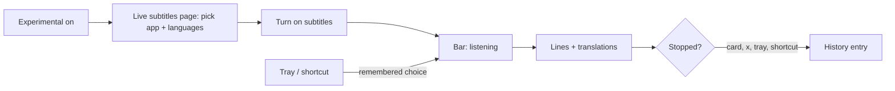

# SpeakEase — Live subtitles (UX)

> Feature master: read this file first to understand how a user subtitles another app's speech in their own language.
> Deeper rules live in `logic/live-subtitles.md`; the beta plan and its measurements in
> `ai-memory/plans/live-subtitles-beta.md`.

## Purpose

- Problem: a video, call or podcast in a language the user follows slowly; YouTube's own captions cover only YouTube
  and translate line by line without the topic.
- Audience: the owner first, then anyone who turns on App › Experimental (beta).
- Success signal: the translation of a line is on screen within 3 s of the speaker finishing it, reads naturally, and
  works for YouTube in a browser, Zoom and a podcast app.

## Scope

- Included: the Live subtitles page, the floating bar, the tray item, the shortcut on Recording, the History
  entry a session leaves.
- Excluded: dictation (`ux/dictation.md`); the History page itself (`ux/history.md`); cloud translation (owner,
  20/10: on-device only).

## Current truth

- **Where it lives**: with App › Experimental on, the side column gains **Live subtitles** between Files & links and
  History - its own page, because it is used differently from dictation (another app's sound, not your voice).
  Recording lists a **Live subtitles** shortcut (⌃⌥⌘S by default); the tray gains a **Live subtitles** item with a tick
  while it runs. On macOS older than 14.2 the page says it needs 14.2.
- **Page**: a top block with the state ("Ready to subtitle Google Chrome", "Subtitling Google Chrome", or an error in
  plain words), the shortcut, and **Turn on subtitles** / **Turn off subtitles**; then **Listen to** - running apps
  as a list to pick from, those playing sound first with a "playing" mark; then **Languages** - the spoken language
  → the one to read (the shared translate language unless that is the spoken one); four short notes (on-device, reads the title for context, saved to History, the one-time permission) sit behind an info icon beside the title, and the list's hint behind one beside **Listen to**. The choices lock while subtitles run.
- **Bar**: a rounded panel at the bottom centre of the screen with the pointer, above the Dock. It never takes focus
  from the app being watched. It rolls through the **last three lines**, oldest at the top: each shows what was said,
  small and grey, with its translation under it, larger (two lines at most), or three soft dots while it is being
  translated. The newest translated line is at full strength; older ones fade, so a line can still be read after the
  next one starts. When a sentence spans two lines, one translation of the whole sentence takes their place. The
  panel grows upward as lines arrive and never leaves empty glass over the video. After 6 s of silence it fades to
  half strength. Drag it anywhere; it opens there next time. **×** turns subtitles off.
- **Before the first line**: "Getting subtitles ready…", then "Listening to <app>…".
- **Ending**: from the card, the bar's ×, the tray or the shortcut. What was heard is saved to History as one entry,
  titled with what was playing (a YouTube video's title, a file's name) or the app's name, with the translation as
  its AI version.
- **Tray and shortcut**: start with the app and languages used last; with none yet, they open the Live subtitles page.
- **Errors** (card line or bar): macOS too old; no recognition model; the app played nothing for 30 s; SpeakEase may
  not record system audio (with where to allow it); the speech detector did not start.
- **Permission**: the first start asks macOS for "record system audio" for SpeakEase; Accessibility, already granted
  for pasting, lets it read the app's window title for context.

## Screens and states

| Screen              | States                                                     | Entry                                                                | Exit / next                                             |
| ------------------- | ---------------------------------------------------------- | -------------------------------------------------------------------- | ------------------------------------------------------- |
| Live subtitles page | unsupported · no app chosen · ready · running · error      | side column (Experimental on), tray/shortcut with nothing remembered | bar                                                     |
| Bar                 | getting ready · listening · lines · quiet (dimmed) · error | start from card, tray, shortcut                                      | ×, card, tray, shortcut → History entry                 |
| Tray item           | hidden · off · on (ticked)                                 | tray menu                                                            | starts or stops; opens Speak when nothing is remembered |

## Flow

## Reading order

| File                                     | Role                                |
| ---------------------------------------- | ----------------------------------- |
| this file                                | current truth                       |
| `logic/live-subtitles.md`                | rules + REQ-IDs (SE-LIVE-…)         |
| `ai-memory/plans/live-subtitles-beta.md` | plan, measurements, open work       |
| `decisions.md`                           | owner rounds 1 and 2 (16/10, 20/10) |

## Change log

- 2026-10-20: the bar rolls through the last three lines (owner: one line went by before it could be read).
- 2026-10-20: the page's descriptions moved behind info icons (owner).
- 2026-10-20: moved from a card on Speak to its own page in the side column (owner: its UX differs from dictation).
- 2026-10-20: created - the card, the bar, tray item and shortcut, History entry (beta, behind Experimental).
